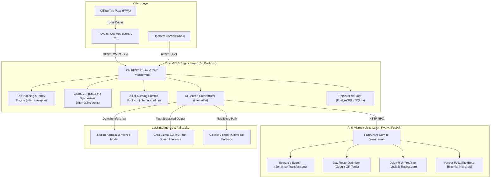
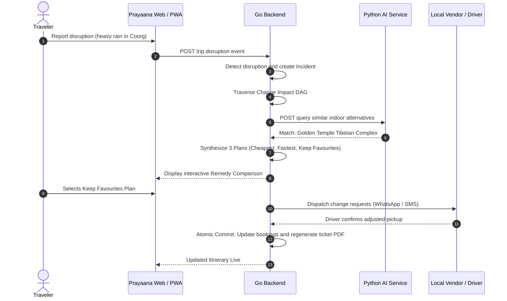

<div align="center">

# 🌿 Prayaana (ಪ್ರಯಾಣ)
### AI-Powered Karnataka Travel Planner & Autonomous Operations Platform

[](https://nextjs.org/)
[](https://golang.org/)
[](https://fastapi.tiangolo.com/)
[](https://www.postgresql.org/)
[](https://python.org/)
[](LICENSE)

*A production-grade, end-to-end intelligent travel concierge and operator system tailored exclusively for the state of **Karnataka, India**.*

</div>

---

## 🎯 Problem Statement

> **AI Travel Planner for Karnataka**  
> *Develop an AI-powered travel planner that creates personalized Karnataka itineraries based on a traveller’s interests, available time, budget, and preferred type of experience.*

---

## 🧭 About Prayaana

**Prayaana** (*Sanskrit / Kannada for "Journey" or "Voyage"*) is designed from the ground up to solve the real challenges of exploring Karnataka — from navigating the misty hairpins of the Western Ghats to timing sunrise at the Vijayanagara ruins of Hampi.

Unlike static itinerary generators that merely output bullet points, Prayaana delivers an **active, resilient trip management ecosystem**:
1. **Travel DNA Personalization**: Learns each traveler's 6 psychological traits (Adventure, Nature, Culture, Food, Luxury, Social), morning vs. night pace, and budget constraints.
2. **Rich Karnataka Catalog**: Deeply grounded in **16 premier destinations**, **58 curated activities**, **28 stays**, **22 transit connections**, and **69 local vendors**.
3. **Dynamic Self-Fixing Itinerary Engine**: Real-time incident detection (monsoon downpours, dam discharges, Ghat landslides, train delays). Uses a **Change Impact Map** to forward-propagate constraints and synthesize three concrete remedy plans (*Cheapest*, *Fastest*, *Keep Favourites*).
4. **All-or-Nothing Vendor Coordination**: Coordinates with homestays, private cab drivers, and coracle operators with atomic commits — preventing half-updated trips.
5. **Interactive Karnataka Travel Guru**: Live conversational AI providing regional culinary tips, cultural etiquette, Kannada emergency assistance, and local travel tips.
6. **Offline Trip Pass (PWA)**: Works completely offline when traveling through deep forested reserves (Bandipur, Kabini) or high-altitude coffee estates with zero cell reception.

---

## 🏛️ Karnataka Coverage & Geographic Regions

Prayaana organizes Karnataka into 5 distinct geographical zones and 6 curated circuits:

| Region | Regional Identity | Destinations Covered | Highlights |
|---|---|---|---|
| ☕ **Malenadu** | The Emerald Western Ghats | Coorg, Chikmagalur, Sakleshpur, Jog Falls | Coffee estate homestays, Mullayanagiri peaks, Abbey falls, Bylakuppe Tibetan monastery |
| 🌊 **Karavali** | The Arabian Coast | Gokarna, Udupi, Mangalore, Murdeshwar | Om Beach, Krishna Mutt, coastal temple architecture, Mangalorean seafood |
| 🪨 **Aitihasika** | UNESCO World Heritage & Stone Architecture | Hampi, Badami, Belur & Halebidu | Vijayanagara ruins, Badami cave temples, Hoysala stone carvings |
| 🐅 **Aranya** | Wildlife Reserves & Rainforests | Kabini, Bandipur, Dandeli | Nagarhole tiger safaris, Kali river white-water rafting, hornbill trails |
| 🏙️ **Rajadhani & Royal** | Capitals & Royal Heritage | Bengaluru, Mysuru | Mysuru Palace, Devaraja Market, Chamundi Hill, Bengaluru tech-garden culture |

---

## 🏗️ System Architecture



---

## 🔄 Dynamic Self-Fixing Sequence

When an adverse event occurs on a trip (e.g., severe rainfall shuts down outdoor excursions), Prayaana executes an autonomous repair pipeline:



---

## 🛠️ Technical Stack

| Layer | Technologies | Role in Prayaana |
|---|---|---|
| **Frontend** | Next.js 16 (App Router), React 19, TypeScript, Tailwind CSS, Motion, Phosphor & Lucide Icons | Responsive traveler interface, interactive DNA quiz, offline Trip Pass, dynamic Change Impact visualizations. |
| **Backend API** | Go (Golang 1.23), Chi Router, pgx, SQLc / SQLite / PostgreSQL | Core business logic, booking management, atomic multi-party confirmation rounds, pricing parity engine. |
| **AI Microservice** | Python 3.12, FastAPI, Uvicorn, Pytest | Semantic search, delay risk regression, OR-Tools day schedule optimization, vendor reliability scoring. |
| **Vector Search** | `sentence-transformers/all-MiniLM-L6-v2`, pgvector / NumPy memory index | "Search-by-feeling" (*"peaceful temple walk with filter coffee"*), activity similarity matrix. |
| **Optimization** | Google OR-Tools (Vehicle Routing with Time Windows) | Optimal sequencing of daily sights respecting open/close hours, transit duration, and traveler pace. |
| **LLM Inference** | Nugen Aligned Travel Model, Groq (`llama-3.3-70b-versatile`), Google Gemini (`gemini-2.0-flash`) | Strict JSON-schema structured output, on-tour chat assistant, operational what-if reasoning. |

---

## 🚀 Getting Started Locally

### Prerequisites
- **Node.js** v20+ & npm
- **Go** v1.22+
- **Python** 3.12+

### 1. Clone the Repository
```bash
git clone https://github.com/ryuma04/prayaana.git
cd prayaana
```

### 2. Start the Python AI Microservice
```bash
cd services/ai
python -m venv .venv
# Windows:
.venv\Scripts\activate
# Linux/macOS:
# source .venv/bin/activate

pip install -r requirements.txt
python -m uvicorn app.main:app --port 8090 --reload
```
*Verify: Visit `http://localhost:8090/health` (returns status `ok` and semantic activity count).*

### 3. Start the Go Backend API
```bash
cd backend
# Optional: copy and customize environment variables
cp .env.example .env

go run ./cmd/api
```
*The Go API seeds the Karnataka demo catalog and starts on `http://localhost:8080`.*

### 4. Start the Next.js Frontend
```bash
cd frontend
npm install
npm run dev
```
*The frontend web app will be available at `http://localhost:3000`.*

---

## 🧪 Running the Test Suites

All components feature comprehensive unit and integration tests:

### Python AI Service Tests (15 tests)
```bash
python -m pytest services/ai/tests/ -v
```
Verifies routing optimizer, constraint validation, delay-risk model, vendor reliability, and ops agent tool guardrails.

### Go Backend Tests & Parity
```bash
cd backend
go test ./...
```
Verifies financial calculations, promo code validations, and catalog parity with the frontend.

### Frontend TypeScript Verification
```bash
cd frontend
npx tsc --noEmit
```

---

## 👥 Demo Logins

When testing the deployed or local app, pre-seeded accounts are available (password: `demo1234`):

| Role | Email | Password | Access Area |
|---|---|---|---|
| **Traveler** | `rahul@prayaana.demo` | `demo1234` | Full trip planning, bookings, live trip pass, Travel Guru AI |
| **Tour Operator** | `ops@saffrontrails.demo` | `demo1234` | `/ops` Operator Console, incident maps, vendor dispatch |
| **Super Admin** | `admin@prayaana.internal` | `demo1234` | `/super-admin` Platform overview, guide approvals |

---

## 📄 License

This project is licensed under the [MIT License](LICENSE). 
